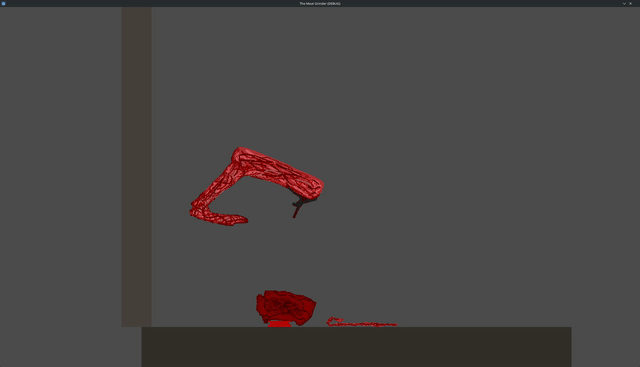
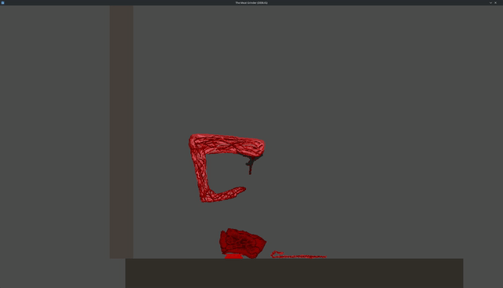
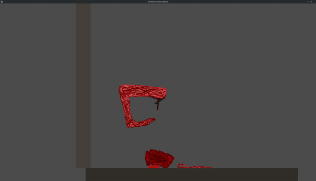

## The Meat Grinder Game

The Meat grinder is an unfinished 2D physics based game project, developed using Godot and C#.
The project primarily focuses on creating a physically simulated claw for interacting, manipulating and breaking apart soft body physics objects.

The main goal was to experiment with physics driven gameplay, particularly in creating a claw that feels good to move around and control using controller and keyboard / mouse. It responds naturally to movement and the environment by applying forces and calculating collisions, rather than moving based on only the players input.

### Project status: Unfinished / Discontinued

## Features
- Physics based claw player object: A multi part claw constructed by several separate rigid body physics objects. Operated by applying forces based on the players input.
- Custom control system: The mouse is simulated as an "analog" stick for movement.
- Soft body physics: Uses soft body physics interactions, using SoftBody2D - https://godotengine.org/asset-library/asset/1621
- Custom settings menu: Sounds, deadzone, display, and control settings, as well as saving and loading to / from a file.

### Gameplay

## Technical Details

### Claw
The claw is built from 3 separate RigidBody2D objects, top, middle, and bottom. Each connected by a PinJoint2D.
(Scenes/Physics/claw.tscn)

All player inputs apply a force to the claw object, instead of moving in a direction by x amount.
(Code/Physics/ClawMove.cs)

There is a custom IntegrateForces override, which allows for each claw part to have its maximum and minimum rotation specified in degrees, to limit each claw segments movement as the Godot joints do not work correctly and allow movement outside their specified range. (Code/Physics/ClawPart.cs)

### Controls

The project supports keyboard / mouse (KBM) and controller input. Switching from either input is detected automatically and the controls are updated based on the current input device.

When KBM controls are used, the mouse movement is "converted" to be like an analog stick, where the mouse is limited to a specified circle area (radius adjustable in settings). The claw gradually moves towards the position of the mouse cursor, but the mouse cursor stays in place. This prevents the claw from moving continuously in one direction when the mouse is moved away from the claws 0,0 coordinate.

This is basically emulating the right analog stick with the mouse, where the mouse needs to continuously be moved / held in a direction for it to keep moving that way.

The claw rotation and movement of its segments is much simpler. The keyboard and left analog stick movement is basically identical. Where the keyboard mirrors the left stick movement.
Left / right analog movement is the same as A / D movement.
This is also the case with up / down with W / S, as well as left / right bumpers with Q / E.
(Code/Physics/ClawMove.cs)

## Art

All original pixel art used in the project was created by me, as well as all visual elements and interfaces.

I wanted to develop the games visual identity alongside its mechanics, giving me the opportunity to work on both the programming and artistic aspects of game development.

The artwork demonstrates some of my experience with creating pixel art sprites, as well as designing visual assets for a game.

### Artwork Showcase

### Artwork Copyright

All original artwork created for this project is protected by copyright and is not covered by the repository's MIT Licence.

The artwork is available for public viewing and inspiration only. Reproduction, redistribution or use of the original assets in other projects requires permission from the copyright holder.

See LICENSE-ARTWORK for details.

## Project Status

Development on this project has been discontinued. This game is not finished or polished.

This project served as an opportunity to experiment with godot's physics systems, using rigid body and soft body interactions, as well as learning more about how controller interaction works and experimenting with UI elements with the settings menu.

Although the game is unfinishe, the repository contains the work completed during development and demonstrated some of the technical challenges involved with building a physics based game.

---

*This project was developed as an independent game*